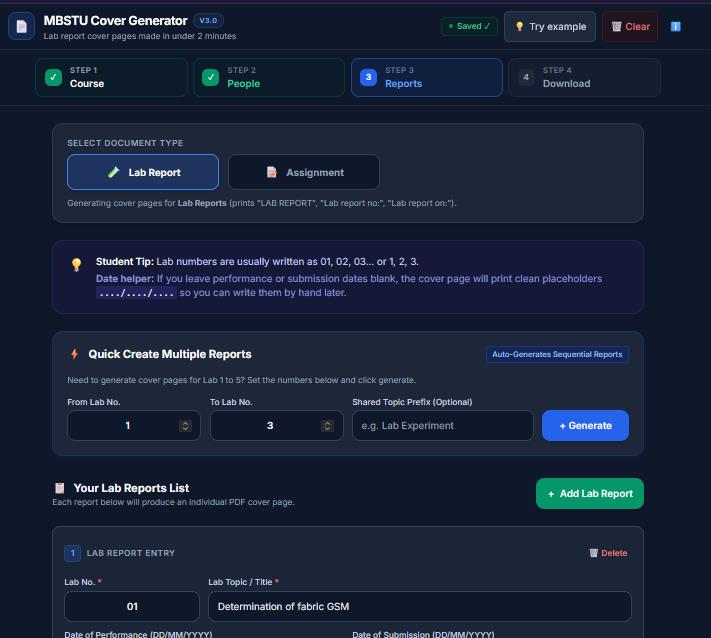
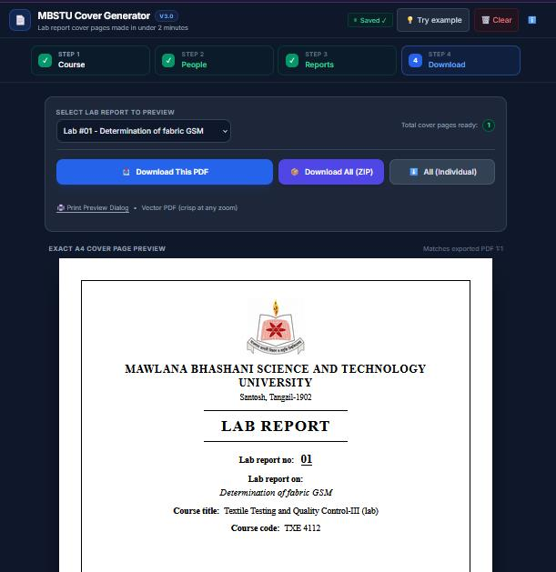

<p align="center">
  
</p>

<h1 align="center">MBSTU Cover Page Generator</h1>

<p align="center">
  <strong>Standardized, high-quality vector PDF cover page generator for Mawlana Bhashani Science and Technology University (MBSTU) lab reports and assignments.</strong>
</p>

<p align="center">
  <a href="https://mbstucover.netlify.app/">
    
  </a>
  <a href="LICENSE">
    
  </a>
  
  
  
  
</p>

<p align="center">
  🚀 <strong>Live Website:</strong> <a href="https://mbstucover.netlify.app/">https://mbstucover.netlify.app/</a>
</p>

---

## 📌 Overview

The **MBSTU Cover Page Generator** is a fast, free, open-source online utility designed for students at **Mawlana Bhashani Science and Technology University (MBSTU)** to create official, standardized A4 vector PDF cover pages for **MBSTU lab reports** and **course assignments**. Created especially for Textile Engineering and engineering departments, it features the official university monogram, automatic sequential batch generation, strict `DD/MM/YYYY` date formatting, and real-time on-screen preview.

The XML sitemap is accessible at [`sitemap.xml`](https://mbstucover.netlify.app/sitemap.xml) and all optimized media assets are located in the [`media/`](media/) directory.

---

## ✨ Features

- **Dual Mode (Lab Report vs. Assignment)**: Switch instantly between Lab Report (`LAB REPORT`, `Lab report no:`, `Lab report on:`) and Assignment (`ASSIGNMENT`, `Assignment no:`, `Assignment title:`) layouts.
- **Embedded Official Monogram**: The official MBSTU logo is integrated directly as an offline base64 asset with options to upload custom monograms or reset with one click.
- **Vector-Accurate PDF Output**: Direct mathematical vector geometry using `jsPDF` ensures pin-sharp text and borders at any printer DPI or zoom level.
- **Sequential Batch Generator**: Auto-generate cover pages for multiple labs or assignments (e.g., Lab 01 to Lab 05) with sequential numbering and shared topics.
- **Flexible Downloads**: Export single vector PDFs, download bundled `.zip` packages via `JSZip`, or trigger sequential multi-file downloads.
- **Strict `DD/MM/YYYY` Dates**: Includes a calendar picker 📅 and automatically outputs neat handwriting placeholders (`..../..../....`) when left blank.
- **Automatic Local Caching**: Saves entered course, student, and teacher details in browser `localStorage`.
- **100% Private & Client-Side**: No backend servers, no analytics, no cookies, and no tracking. Everything runs directly inside your web browser.

---

## 📸 Application Walkthrough

### Step 1: Course Information & Logo Setup
Configure course metadata and preview or customize the university monogram.

<p align="center">
  
</p>

---

### Step 2: Student & Faculty Details
Enter student name, ID number, session, and teacher's name and designation.

<p align="center">
  
</p>

---

### Step 3: Reports / Assignments & Sequential Generator
Switch between **Lab Report** and **Assignment** modes, auto-generate sequential entries, and set dates.

<p align="center">
  
</p>

---

### Step 4: Live 1:1 A4 Preview & Multi-Format Downloads
Inspect the exact vector layout on an authentic A4 sheet before exporting.

<p align="center">
  
</p>

---

## 📄 Downloaded PDF Samples

Standardized output comparison for both modes:

| MBSTU Lab Report Sample | MBSTU Assignment Sample |
| :---: | :---: |
|  |  |

---

## 🚀 Getting Started

### Option 1: Use Live Online
Open **[mbstucover.netlify.app](https://mbstucover.netlify.app/)** in any modern web browser on desktop or mobile.

### Option 2: Run Locally (Offline)
No build process or packages required:
1. Clone this repository:
   ```bash
   git clone https://github.com/your-username/mbstu-cover-generator.git
   cd mbstu-cover-generator
   ```
2. Double-click `index.html` to open it in Chrome, Edge, Firefox, or Safari.

---

## 🌐 Netlify Deployment

This repository is pre-configured with `_redirects` and robots/sitemap support for **Netlify**:
1. Drag and drop the folder into [Netlify Drop](https://app.netlify.com/drop) or link your GitHub repo.
2. Build command: *(none)*
3. Publish directory: `.`

---

## 👤 Developer & Maintainer

Designed and developed with ❤️ for students by:

- **Nomun Sheikh**
- **Instagram:** [@sheikh.nomun](https://www.instagram.com/sheikh.nomun/)
- **Email:** [nomun.s@outlook.com](mailto:nomun.s@outlook.com)
- **Institution:** Mawlana Bhashani Science and Technology University (MBSTU)

---

## 📜 License

This project is licensed under the [MIT License](LICENSE) — free to use and adapt for academic and personal purposes.
