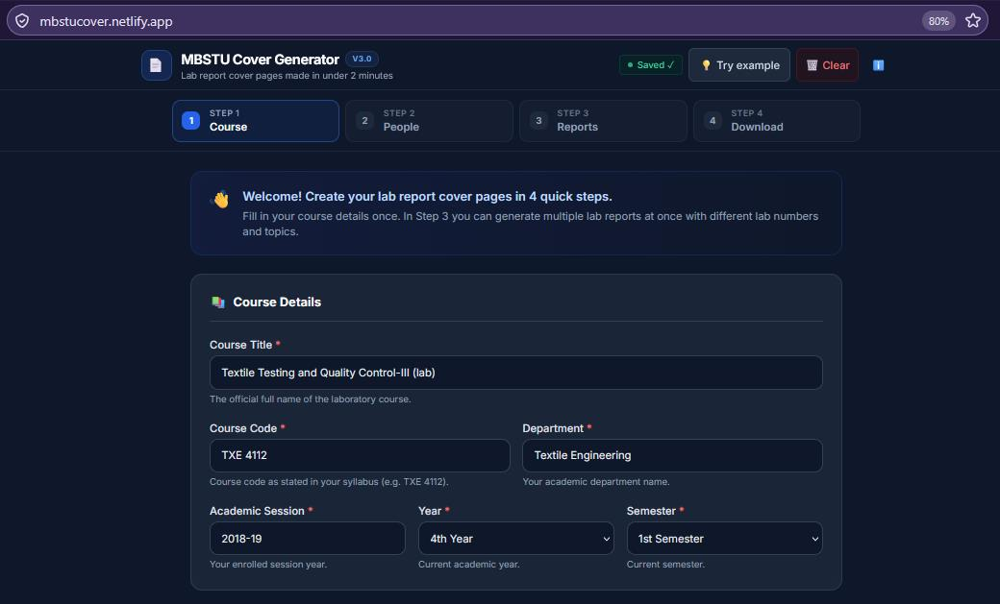
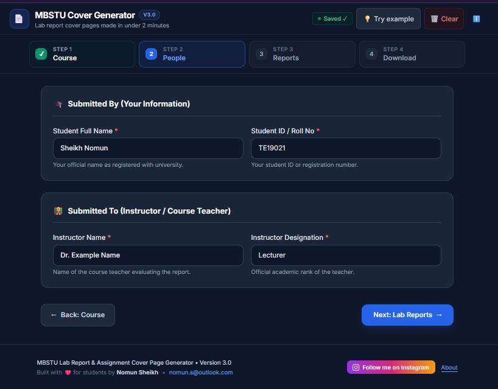
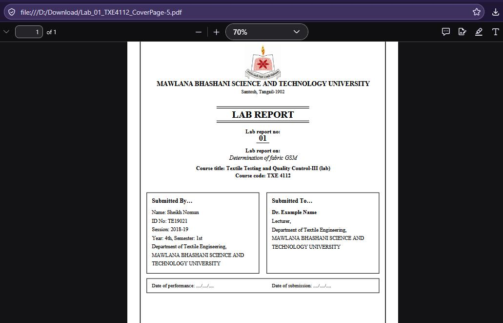
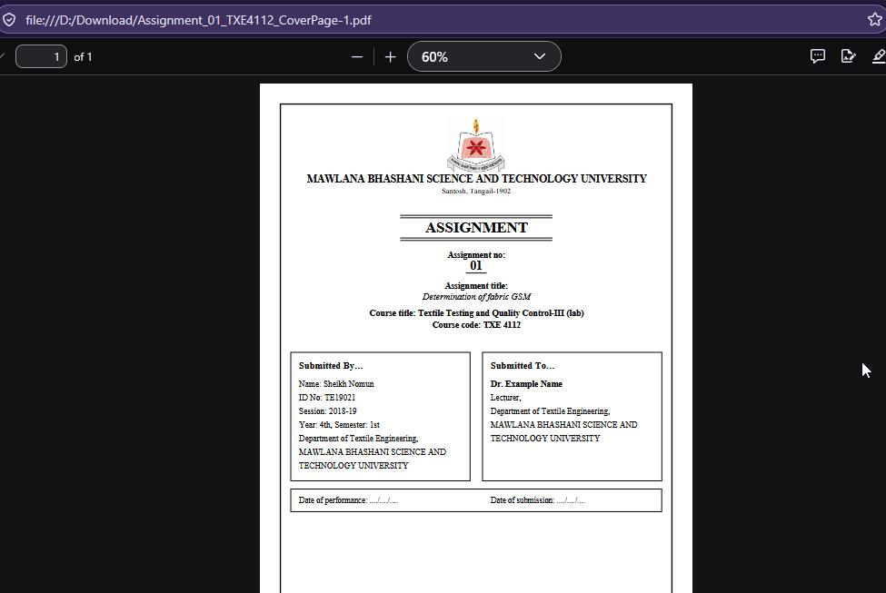

<p align="center">
  
</p>

<h1 align="center">MBSTU Cover Page Generator</h1>

<p align="center">
  <strong>Standardized, high-quality vector PDF cover page generator for students at Mawlana Bhashani Science and Technology University (MBSTU).</strong>
</p>

<p align="center">
  <a href="https://mbstucover.netlify.app/">
    
  </a>
  <a href="LICENSE">
    
  </a>
  
  
  
  
</p>

<p align="center">
  🚀 <strong>Live Website:</strong> <a href="https://mbstucover.netlify.app/">https://mbstucover.netlify.app/</a>
</p>

---

## 📌 Overview

The **MBSTU Cover Page Generator** is an open-source, client-side web utility created to help engineering and academic students at **Mawlana Bhashani Science and Technology University** generate clean, uniform, and print-ready A4 cover pages in under two minutes.

Whether you need cover pages for regular **Lab Reports** or course **Assignments**, this tool eliminates misaligned templates, distorted monograms, and repetitive copy-pasting across sequential submissions.

---

## ✨ Key Features

- **Dual Document Support**: Toggle seamlessly between **Lab Report** and **Assignment** modes. Headers, report numbering, and titles adapt dynamically.
- **Embedded Official Monogram**: The MBSTU university logo is embedded by default as an optimized base64 vector asset. Works offline with zero image loading or CORS errors. You can also upload a custom monogram or remove it as needed.
- **True Vector PDF Export**: Generates ultra-crisp vector PDFs directly through `jsPDF`. Text and shapes remain sharp at any zoom level, avoiding canvas-based blurriness.
- **Interactive 4-Step Flow**:
  1. **Course Info**: Course Title, Course Code, Department, Session, Year, and Semester.
  2. **People Details**: Student Name, Student ID, Instructor Name, and Designation.
  3. **Reports & Assignments**: Individual report topics, dates, and quick batch generation.
  4. **Preview & Download**: Exact 1:1 on-screen A4 sheet preview and one-click downloads.
- **Quick Batch Generator**: Create sequential reports (e.g. Lab 01 through Lab 05) with automated numbering and shared topic prefixes in seconds.
- **Flexible Downloads**:
  - Download individual PDFs.
  - Download all entries bundled in a single `.zip` file (via `JSZip`).
  - Automated sequential download option with progress tracking.
- **Strict `DD/MM/YYYY` Date System**: Uses standardized date formatting paired with a calendar picker 📅. Leaving dates blank automatically renders handwriting placeholders (`..../..../....`).
- **Browser Auto-Save**: Automatically preserves your progress in `localStorage` so you never lose form details when closing or refreshing the tab.
- **Mobile-First & Dark UI**: Beautiful, accessible dark theme optimized for all screen sizes (responsive down to 375px mobile viewports).
- **100% Private & Serverless**: Runs entirely in your browser. No databases, no telemetry, and no personal data ever leaves your device.

---

## 📸 Application Walkthrough

### Step 1: Course Information & Logo Setup
Configure course metadata and preview or customize the university monogram.

<p align="center">
  
</p>

---

### Step 2: Student & Faculty Details
Enter your student name, ID number, session, and your teacher's name and designation.

<p align="center">
  
</p>

---

### Step 3: Reports / Assignments & Sequential Generator
Switch between **Lab Report** and **Assignment** modes, auto-generate sequential entries, and set dates.

<p align="center">
  
</p>

---

### Step 4: Live 1:1 A4 Preview & Multi-Format Downloads
Inspect the exact vector layout on an authentic A4 sheet before exporting.

<p align="center">
  
</p>

---

## 📄 Downloaded PDF Showcase

Here is how exported PDFs look when downloaded and printed:

| Lab Report Cover Page | Assignment Cover Page |
| :---: | :---: |
|  |  |

---

## 🚀 Getting Started

### Option 1: Use the Live Web Application
Visit **[mbstucover.netlify.app](https://mbstucover.netlify.app/)** directly from any desktop, tablet, or phone browser.

### Option 2: Run Offline / Locally
Because the application is completely self-contained in a single file (`index.html`), no setup or installation is required:

1. Clone or download this repository:
   ```bash
   git clone https://github.com/your-username/mbstu-cover-generator.git
   cd mbstu-cover-generator
   ```
2. Double-click `index.html` to open it in your browser (Chrome, Firefox, Edge, Safari).
3. No `npm install`, node server, or build steps required!

---

## 🌐 Deploying to Netlify

This repository is ready for instant zero-configuration hosting on **Netlify**:

1. Log into [Netlify](https://app.netlify.com/).
2. Drag and drop the project folder directly into **Netlify Drop**, or link your GitHub repository.
3. Configure settings:
   - **Build command**: *(Leave blank)*
   - **Publish directory**: `.` (Root directory)
4. Your site will deploy in seconds.

---

## 🛠️ Built With

- **HTML5 & Vanilla JavaScript**: Fast, dependency-free application logic.
- **[Tailwind CSS](https://tailwindcss.com/)**: Modern responsive layout and dark UI design.
- **[jsPDF](https://github.com/parallax/jsPDF)**: Client-side vector PDF composition and rendering.
- **[JSZip](https://stuk.github.io/jszip/)**: Client-side archiving for bundled ZIP downloads.

---

## 👤 Developer & Maintainer

Designed and developed with ❤️ for students by:

- **Nomun Sheikh**
- **Instagram:** [@sheikh.nomun](https://www.instagram.com/sheikh.nomun/)
- **Email:** [nomun.s@outlook.com](mailto:nomun.s@outlook.com)
- **Institution:** Mawlana Bhashani Science and Technology University (MBSTU)

Feel free to connect on Instagram or open an issue if you have suggestions or departmental template requests!

---

## 📜 License

This project is licensed under the [MIT License](LICENSE) — free to use, modify, and distribute for personal and educational purposes.
